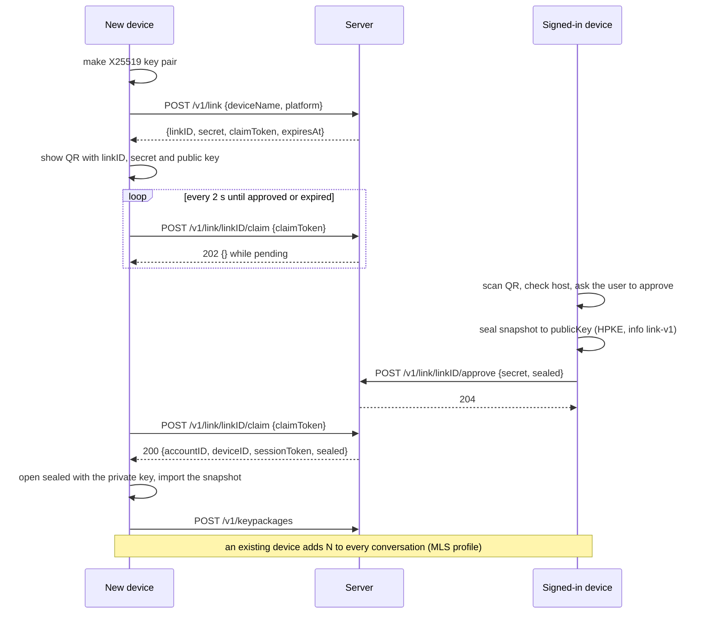

# Device Linking

**Status:** draft for owner review (authentication and keys).
**Builds on:** [server design §7.1](../superpowers/specs/2026-10-27-server-design.md#71-identity-lane-a) (the three link endpoints); [roadmap identifiers](../superpowers/plans/README.md#identifiers) (the QR format); [plan 6](../superpowers/plans/2026-10-27-client-networking.md) (account flow); [plan 7](../superpowers/plans/2026-10-27-client-messaging.md) (the snapshot).

Linking adds a new device to an account that already has one, without a passkey or an email code. The new device shows a QR code. A device that is already signed in scans it and approves. The approving device also seals a snapshot of the account's local data so that only the new device can read it. The server relays the snapshot and cannot open it.

## Values

| Value | Made by | Notes |
|---|---|---|
| `linkID` | server | Names the link in the URL path |
| `secret` | server | 16 random bytes, stored hashed. Proves that the approver saw the QR code. |
| `claimToken` | server | 16 random bytes, stored hashed. The new device keeps it in memory only. |
| `expiresAt` | server | 5 minutes after `POST /v1/link`, or at the first claim |
| Link key pair | new device | A fresh X25519 key pair for each link attempt. The private key stays in memory and is dropped after the claim or the expiry. |

## Sequence



The request and response shapes are in the server design. The claim answers `200` exactly once. After that, or after 5 minutes, it answers `expired`.

## The QR code

The QR code holds this URL, and the app-site association lets the app open it as a universal link:

```text
https://<host>/link/<linkID>#<secret>.<X25519 public key, base64url>
```

- `<secret>` is the string that `POST /v1/link` returned. `<public key>` is the 32-byte key in base64url without padding. Neither contains a `.`, so the fragment has exactly one `.`. The scanner rejects a fragment with any other count.
- The fragment is never sent to the server in an HTTP request, and the new device never sends its public key to the server. The server therefore cannot make a `sealed` value that the new device would accept.
- The scanning device MUST refuse a code whose host is not its own server's host, and MUST send nothing to that host (plan 6, `wrongServer`). Otherwise it would hand this account's `secret` to another server ([threat model](../security/threat-model.md#511-device-linking), LNK-T-01).

## What goes in `sealed`

`sealed` is the HPKE seal of a JSON document to the public key from the QR code. The suite is the shared one in the [README](README.md#conventions), the `info` is `link-v1`, and the layout is `enc ‖ ct`. On the wire it is base64url without padding in the `sealed` field, and the server allows at most 64 KiB of it.

The plaintext is plan 7's `LinkSnapshot`:

```json
{"v":1,"contacts":[],"chats":[{"id":"","isRequest":false,"muted":false}],"folders":[],"blocked":[],"settings":{}}
```

It holds the contacts, the chats (not their messages), the folders, the blocked accounts and the settings. Plan 7 owns the exact field types. The snapshot holds no keys and no message text.

The new device opens `sealed` with its private key. If `sealed` is missing or does not open, it MUST discard the whole value and import nothing. The link still works. The account just starts with an empty contact list.

## What the new device gets

| Data | How it arrives |
|---|---|
| Account ID, device ID, session token | The `200` claim response |
| Display name | `GET /v1/me`, after the claim. The server keeps display names in plain text. |
| Contacts, chats, folders, blocked accounts, settings | The sealed snapshot |
| Membership in each conversation | A Welcome from a device that already belongs ([MLS profile](mls-profile.md#a-linked-device-joins)) |
| Its own MLS signing key | Made on the device. No key crosses the link. |
| Message history | None. History needs encrypted backups, which come in Phase 2. |

## What each side checks

- **The approver** checks that the host in the QR code is its own server's host. It then shows an approval prompt. Today the prompt is a scan or a paste with no further step.
- **The new device** checks that `sealed` opens. It cannot check which account approved the link, because the claim response gives it no way to compare ([OPEN-8](../security/threat-model.md#open-8-device-link-gaps)).
- **The server** checks that `secret` matches, that the link has not expired and that it has not been claimed yet. Limits: link start 10 per hour per IP, claim 60 per minute per link.

## Threats

The linking rows of the threat model cover this flow ([section 5.11](../security/threat-model.md#511-device-linking)):

| Row | What it covers |
|---|---|
| LNK-S-01, LNK-S-03 | Someone who sees the QR code, or sends a link, gets the user to approve their device |
| LNK-S-02 | Guessing a link ID or secret |
| LNK-T-01 | A code for another server is approved |
| LNK-T-02, LNK-I-01 | The server swaps the key or reads the snapshot |
| LNK-I-02 | A claim token leaks or a claim is replayed |
| LNK-R-01, LNK-E-01, LNK-E-02 | Unnoticed devices and full rights for every device |
| LNK-D-01 | Spamming link start |

Approving a link gives the new device read access to all future messages. The approval prompt is too easy to abuse today ([OPEN-24](../security/threat-model.md#open-24-approving-a-device-link-is-too-easy-to-abuse)), and nobody is told when a device is added ([OPEN-7](../security/threat-model.md#open-7-new-devices-are-added-silently)).

## Open points

- **Plan 6 does not produce this QR code.** Its linking task builds `https://<host>/link/<linkID>#<secret>` and sends no `sealed` data. This document needs plan 6's linking task to make the new device generate the X25519 key, put it in the QR code, and open `sealed`, and the approving device to seal the snapshot. Until then, the snapshot is either not sent or readable by the server ([OPEN-8](../security/threat-model.md#open-8-device-link-gaps)).
- **Who builds the snapshot:** plan 7 says plan 6 seals it, and plan 6 lists it as out of scope. One of them has to own it.
- **A snapshot over 64 KiB:** the server limit is on `sealed`, and no plan says what the approver does with a very large contact list.
- **Approval prompt:** the prompt that names the new device, asks for Face ID or Touch ID, and says plainly what the device can read is a proposal, not part of version 1 (OPEN-24).

Test vectors: none yet. The roadmap expects a link-sealing vector, but plan 9 Task 4 defines no file for it.
