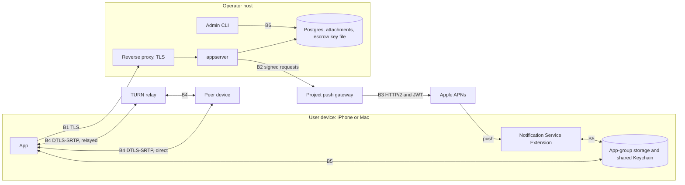

# Threat Model

**Status:** draft, not yet reviewed by the owner (see [Review log](#9-review-log)).
**Applies to:** the Phase 1 design as written in the plans dated 2026-10-27 ([roadmap](../superpowers/plans/README.md)), [GOAL.md](../../GOAL.md) §5–7 and §16–17, and the [server design](../superpowers/specs/2026-10-27-server-design.md).
**Checker:** `python3 scripts/check-threat-model.py` (rules in [section 1](#1-scope-and-method)).

## 1. Scope and method

This document lists what we protect, who attacks it, where the trust boundaries are, and what each plan task does about each threat. It is written for a security reviewer. It describes the design as planned, not code that exists. When a plan changes, this document changes with it.

**Method.** STRIDE is applied to each component in [section 5](#5-threats):

| Letter | Meaning | Property at risk |
|---|---|---|
| S | Spoofing | authenticity of a person, device or server |
| T | Tampering | integrity of data, state or code |
| R | Repudiation | accountability for an action |
| I | Information disclosure | confidentiality |
| D | Denial of service | availability |
| E | Elevation of privilege | authorization |

**Row format.** Each threat has an ID such as `SRV-S-01`: a component prefix, the STRIDE letter, and a number. The columns are `ID | STRIDE | Threat | Impact | Mitigation | Residual`.

**Mitigation cells** hold only references, separated by `;`:

- `plan <N> <TaskID>` points at the task in plan N that builds the mitigation. N is the row number in the roadmap table, and the task ID is the one in the plan's `Task <ID>:` heading. Example: `plan 2 A3`.
- `OPEN-<n>` means no plan mitigates the threat. The risk is listed in [section 8](#8-open-risks).

A cited task is a commitment in a plan, not evidence that the code exists or works. The checker proves only that the cited task exists. Evidence comes from the plan's tests, the independent review (plan 9 Task 12) and the beta gate (plan 9 Task 14). Every other claim (what the residual risk is, what an attacker can still do) is prose and needs the reviewer's judgment.

**Components in scope:** server API, WebSocket, delivery and MLS Delivery Service, escrow, push gateway, APNs path, TURN and coturn, iOS app, Notification Service Extension (NSE), macOS app, device linking, admin and operations, build and CI.

**Out of scope for Phase 1** (server design §1): federation, groups of more than two accounts, the SFU and group calls, S3 storage, phone-number discovery, encrypted backups, multiple server nodes, an admin web UI, Android. Also out of scope: a compromised Apple operating system or secure enclave, physical attacks on hardware, and the internal correctness of mls-rs, libwebrtc and libopus (see OPEN-1 and OPEN-16).

**Checker rules** (`scripts/check-threat-model.py`):

- Every row under Threats has a non-empty Mitigation of the form above.
- A `plan N TaskID` reference must match a `Task <TaskID>:` heading in the plan file that row N of the roadmap table links to.
- Every `OPEN-n` used anywhere in this document must be listed under Open risks.
- IDs are unique and well formed.

## 2. Assets

| Asset | Where it lives | Why it matters |
|---|---|---|
| Message plaintext | On the sending and receiving devices. In server-readable chats also in the escrow copy on the server. | The product's purpose. Mode A promises that no server can read it. |
| MLS private state (epoch secrets, KeyPackage private keys, pending commits) | Files in the app-group container (plan 4 M1), protected `completeUntilFirstUserAuthentication` on iOS | Reading it decrypts messages. Corrupting it breaks a conversation. |
| Device signing keys (MLS signature key) | Keychain, shared access group, `ThisDeviceOnly` (plan 4 M5) | Lets someone act as that device in every group. |
| Session tokens | Keychain on the device (plan 6 L3a); SHA-256 hash on the server | Bearer credential for the whole API and WebSocket. They never expire (OPEN-9). |
| Passkeys and email-code flows | Passkey private key in iCloud Keychain or the Secure Enclave; public key and credential ID on the server. Email codes: SHA-256 hash on the server, 10 minutes. | Account recovery and sign-in. Email access is account access. |
| Link secrets and claim tokens | QR code on a new device; claim token in memory on that device; hashes on the server | Control which account a new device joins. |
| Push tokens and sealed push handles | APNs token: Apple, the device, and the gateway at send time. The server stores only the sealed handle. | Lets an attacker send notifications to a device. |
| Escrow private key | One X25519 key file on a server host that allows server-readable chats (`APP_ESCROW_KEY_FILE`) | Decrypts every escrow copy within retention. |
| APNs key (`.p8`) | Push gateway host only, held by the owner | Anyone holding it can push to every installation of the app. |
| TURN secret (`APP_TURN_SECRET`) | App server and each relay's `static-auth-secret` | Anyone holding it can mint TURN credentials. |
| Gateway HPKE private key | Push gateway host | Opens every sealed push handle. |
| Server Ed25519 push key | One per self-hosted server (`APP_PUSH_KEY_FILE`) | Authenticates that server to the gateway. |
| Metadata (server design §9) | Server database and logs, gateway, Apple, relays, network | Who talks to whom and when. See [section 7](#7-metadata-exposure). |
| Call media | RTP between two devices, direct or through a relay | Voice and video. Protected by DTLS-SRTP, with fingerprints exchanged inside MLS. |
| IP addresses | Server (sees them on every connection), relay, call peer, network | Approximate location of a user. |
| Invite codes, usernames, email addresses, display names | Server database | Social graph and contact data. Display names are plain text (OPEN-2). |
| Reports (up to 50 user-shared messages) | Server database and, if configured, the operator's abuse mailbox | Contains plaintext the reporter chose to share. |

## 3. Actors

| Actor | Capabilities | What we assume |
|---|---|---|
| Remote attacker | Sends any request to the public server, gateway and relay ports. Has no account. | Can run scripts from many IP addresses. |
| Malicious user | Holds a valid account (invites are not secret). Can message, call, report, link devices, and send malformed content. | Controls a modified client. |
| Malicious or compromised self-hosted server operator | Controls the host, database, escrow key (if present), logs, proxy and server binary. Can lie to clients about devices, KeyPackages, mode and policy. | Users choose a server, so users trust its operator for availability and metadata, but not for Mode A content. |
| Compromised project push gateway | Holds the APNs key and the gateway HPKE key. Sees APNs tokens and bundle IDs when it sends. Can send any push to any token it can open. | The gateway is a single point of trust that every self-hosted server shares. |
| Apple (APNs) | Sees push token, timing, size and bundle ID. Can drop or delay pushes. | Not malicious, but legally compellable. |
| Network observer | Sees IP addresses, SNI, packet sizes and timing on the path between any two parties. Cannot break TLS or DTLS. | Includes ISPs and Wi-Fi operators. Can block or disrupt traffic. |
| TURN relay operator | Sees both endpoints' IP addresses, timing and volume. Cannot decrypt media. | The project runs the beta relays. Self-hosters run their own. |
| Stolen or unlocked device | Physical access, locked (before or after first unlock) or unlocked. | Attacker may know or lack the passcode. |
| Malicious linked-device scanner (QR shoulder-surf) | Sees or photographs a QR code shown on a new device. May own an account. | Acts within the 5-minute link window. |
| Supply-chain attacker (dependencies, CI, AI-written code) | Publishes or alters a package, a release asset, a workflow, or code written by an agent. | AI agents write most of the code and can invent package names (GOAL §16). |

## 4. Trust boundaries

| ID | Boundary | What crosses | What protects it | What does not |
|---|---|---|---|---|
| B1 | Device and server (TLS) | API calls, WebSocket frames, MLS ciphertext, sealed push handles, call signaling payloads (MLS-encrypted) | TLS to the reverse proxy; bearer session token; MLS for content | No certificate pinning (OPEN-10). The operator sees everything that is not MLS-encrypted, including metadata (OPEN-11). |
| B2 | Server and gateway (signed) | `POST /v1/push` with a sealed handle and a padded payload | Ed25519 signature over method, path, timestamp and body hash; ±300 s window; replay cache; per-server and per-handle limits | A registered server can send to any handle it holds. The replay cache and limits may reset on restart (OPEN-3). |
| B3 | Gateway and APNs | APNs token, bundle ID, padded ciphertext, alert or VoIP type | HTTP/2 with TLS; ES256 JWT, refreshed every 50 minutes | Apple sees all of it. A gateway compromise exposes the APNs key (OPEN-13). |
| B4 | Device and device media (DTLS-SRTP, direct or through TURN) | RTP/SRTP media, STUN/DTLS | DTLS-SRTP; each side's DTLS fingerprint travels inside an MLS message and is compared with the SDP; TURN credentials are short-lived HMAC credentials | IP addresses are visible to the peer (direct) or the relay. Fingerprint binding is only as strong as the MLS identity (OPEN-6). |
| B5 | App and NSE (shared app-group storage) | SQLite database, MLS state files, process lock, Keychain items | Same team ID, app group and Keychain access group; `flock` cross-process lock; file protection classes | Both processes run with the same privileges and hold the same keys. After first unlock, anything that can run code as the app can read them (OPEN-15, OPEN-21). |
| B6 | Admin CLI and database | Invite creation, report listing, escrow export, push registration, lab sessions, migrations | Host access control (SSH keys, loopback admin port); `escrow_access_log` for export | The CLI runs with full database access and, when configured, the escrow key. Nothing stops an operator from bypassing the CLI (OPEN-12). |

## 5. Threats

Every table has the columns `ID | STRIDE | Threat | Impact | Mitigation | Residual`.

### 5.1 Server API

| ID | STRIDE | Threat | Impact | Mitigation | Residual |
|---|---|---|---|---|---|
| SRV-S-01 | S | An attacker guesses the 6-digit email code during sign-up or email sign-in. | Account takeover: a new device on the victim's account. | plan 2 A2; plan 2 A4 | At most 5 attempts per code and 3 codes per hour per email allow about 15 guesses per hour, roughly 1 in 66,000 per targeted email per hour. An attacker working through many emails gets proportionally more hits. |
| SRV-S-02 | S | A stolen session token is replayed from another host. | Full API and WebSocket access as that device. | plan 2 A3; plan 2 A4; plan 6 L3a | Tokens never expire. Only revocation or account deletion ends them (OPEN-9). |
| SRV-T-01 | T | Malformed, oversized or hostile JSON bodies, or unknown fields, reach a handler. | Crash, memory exhaustion, or a handler acting on unvalidated data. | plan 2 F3 | Unknown fields are accepted by design. Plan 2 sets no explicit HTTP read or write timeouts (OPEN-14). |
| SRV-T-02 | T | Two sign-ups race for the same username or the same invite. | Duplicate accounts or an invite used more than its limit. | plan 2 A3; plan 2 A1 | None known. The transaction in sign-up finish is the only guard, so the review should read it. |
| SRV-R-01 | R | A user, or an attacker with a stolen token, later denies having signed in, revoked a device or deleted the account. | No way to attribute account actions. | plan 2 A4 | By design the server logs no IP addresses, emails or tokens (server design §8). The only record is the device list with creation and last-seen times. There is no per-action audit trail. |
| SRV-I-01 | I | Enumeration of accounts through sign-in, user lookup, email discovery or KeyPackage claims. | Attacker learns which usernames or emails exist, or who blocked whom. | plan 2 A4; plan 2 E1; plan 2 B1 | `GET /v1/usernames/{name}` reveals whether a username exists, by design (30 per minute per IP). Timing differences between known and unknown emails are not tested. |
| SRV-I-02 | I | Secrets or personal data end up in logs, error bodies or mail (codes, tokens, emails, IPs, push handles). | Disclosure to anyone with log access. | plan 2 F3; plan 2 A2; plan 2 A3 | Server design §8 forbids logging them, but no listed task adds a test that scans log output. This rests on code review. |
| SRV-D-01 | D | Flooding sign-up start, email sending or passkey options. | Mail bombing of a victim; resource exhaustion. | plan 2 A2; plan 2 F3 | Limits are in memory per process and reset on restart (OPEN-3). An attacker rotating IP addresses avoids per-IP limits but is still held to 3 codes per hour per email. |
| SRV-D-02 | D | Slow or oversized requests tie up the public listener. | The server stops answering. | plan 2 F3; OPEN-14 | Bodies are capped at 1 MiB. Neither plan 2 nor plan 9 Task 11 sets read or write timeouts or a body limit at the proxy; Task 11 configures only HTTPS, HSTS and no access log. The owner should add them to Task 11 (OPEN-14). |
| SRV-E-01 | E | A client spoofs `X-Forwarded-For` to dodge per-IP limits. | Rate limits are bypassed. | plan 2 F3 | The header is trusted only when `APP_TRUST_PROXY=true`, and then only the last hop. Setting it without a proxy lets anyone spoof. Not setting it behind a proxy puts all clients under one IP. |
| SRV-E-02 | E | A user reaches another account's device, conversation, call or attachment by ID. | Cross-account access. | plan 2 A4; plan 2 B2; plan 2 C3; plan 2 E3 | Attachment IDs are 128 random bits and work as the access key for any authenticated user. The content is ciphertext and its key travels inside MLS. |

### 5.2 WebSocket

| ID | STRIDE | Threat | Impact | Mitigation | Residual |
|---|---|---|---|---|---|
| WSK-S-01 | S | A socket is opened with a stolen token. | Attacker receives that device's live events, including call rings. | plan 2 F3; plan 2 C1 | Same as SRV-S-02 (OPEN-9). |
| WSK-S-02 | S | An attacker holding a token opens a second socket, which closes the device's real socket with code 4001. | The real device is knocked offline until it reconnects. | plan 2 C1; plan 6 L2b | The new connection always wins, so two holders of the token can keep replacing each other. Backoff limits the reconnect rate. |
| WSK-T-01 | T | Malformed or oversized frames corrupt hub state or crash the server. | Denial of service for all connected devices. | plan 2 C1 | Plan 2 sets no explicit WebSocket read limit, and frames have no rate limit (OPEN-14). |
| WSK-R-01 | R | A caller or callee denies that a ring, answer or hangup happened. | Disputes over missed calls. | plan 2 C3 | Call state is in memory and forgotten 60 seconds after the end (4 hours after answer). There is no durable record by design (OPEN-3). |
| WSK-I-01 | I | Events or call signals are delivered to a device that is not a participant. | A third party sees ring or signaling traffic. | plan 2 C2; plan 2 C3; plan 2 C1 | None known. |
| WSK-I-02 | I | The server reads call payloads (SDP, DTLS fingerprint, ICE candidates). | Operator learns IP candidates and can swap fingerprints. | plan 8 S1; plan 7 B3 | Payloads are MLS-encrypted, so the server sees only that a call happened, between which accounts, and when (OPEN-11). A server that substitutes KeyPackages can still read them (OPEN-6). |
| WSK-D-01 | D | A client that never reads fills the server's send buffer. | Memory growth per connection. | plan 2 C1 | The buffer holds 64 frames, then the socket closes with 1013, and the device falls back to push and inbox sync. The number of connections is bounded only by the number of devices. |
| WSK-D-02 | D | A malicious user sends `call.invite` to many accounts to ring them and burn their push quota. | Harassment; push limits used up. | plan 2 C3; plan 2 D3; plan 8 K2 | Blocked callers never ring and the gateway allows 20 call pushes per hour per handle. There is no per-sender limit on WebSocket frames (OPEN-14). |
| WSK-D-03 | D | A server restart ends ringing calls and loses call state. | Calls cannot be hung up through the server. | plan 2 C2; plan 8 S3 | Connected calls continue peer to peer. Ringing calls end as missed (OPEN-3). |
| WSK-E-01 | E | A non-participant sends `call.answer`, `call.hangup` or `call.signal` for someone else's call. | Calls hijacked or ended. | plan 2 C3 | None known. |

### 5.3 Delivery and MLS Delivery Service

| ID | STRIDE | Threat | Impact | Mitigation | Residual |
|---|---|---|---|---|---|
| DLV-S-01 | S | A device posts a message or commit as another device. | Forged messages in a conversation. | plan 2 B3; plan 4 M2 | The server checks membership from the token. Recipients verify MLS signatures. A message is attributed to an MLS credential, not to anything the server asserts. |
| DLV-S-02 | S | A malicious operator or a stolen account serves an attacker's KeyPackage when a client claims one. | The attacker joins the conversation and reads later messages. This is undetectable. | OPEN-6 | No plan makes clients verify a contact's keys or checks that a claimed KeyPackage's credential matches the account and device the server named. |
| DLV-T-01 | T | Two devices commit at the same epoch. | Group state forks. | plan 2 B2; plan 4 M2; plan 7 A1 | None known. Exactly one commit wins, the other gets `stale_epoch`. |
| DLV-T-02 | T | A commit adds a device that does not belong to the conversation's accounts. | A rogue device in a group. | plan 2 B2; plan 7 A3 | The server decides which devices belong to an account, so a malicious operator can list a device it controls (OPEN-6, OPEN-7). |
| DLV-T-03 | T | The same ciphertext or commit arrives twice (push and inbox, or a retry). | Duplicate messages, a corrupted group, or a crash. | plan 2 B3; plan 4 M2; plan 7 A2 | None known. |
| DLV-T-04 | T | The operator or an attacker drops, delays or reorders messages and commits. | Silent censorship or confusion. | OPEN-19 | The server assigns `seq` and the inbox cursor, but clients do not check for gaps. |
| DLV-R-01 | R | A sender denies sending a message, or a recipient denies receiving it. | Disputes with no proof either way. | plan 4 M2 | MLS authenticates the sender to group members, but this project makes no non-repudiation claim and receipts are not signed evidence. |
| DLV-I-01 | I | The operator reads message content in a strict E2EE conversation. | Loss of the Mode A promise. | plan 2 B3; plan 4 M2 | The server stores ciphertext only. It still sees who, when and how much (OPEN-11). |
| DLV-I-02 | I | A blocked user learns that they are blocked. | Harassment escalation. | plan 2 B1; plan 2 B3 | A blocked caller sees a missed call after the 45-second timeout, the same as an unanswered call. |
| DLV-D-01 | D | An attacker claims a victim's KeyPackages to exhaust them, or floods a device's inbox. | Chats cannot be started with the victim, or storage grows. | plan 2 B1; plan 2 B3 | Claims are limited to 100 per hour per account and each device's last KeyPackage is never removed. Reusing it weakens forward secrecy (OPEN-17). Inbox rows are kept 30 days. |
| DLV-E-01 | E | A revoked or removed device keeps receiving messages. | Continued access after revocation. | plan 2 B2; plan 2 I1; plan 7 A3 | A removed device keeps the keys of epochs it already saw until another device commits its removal. It cannot fetch new ciphertext because its token is rejected. |
| DLV-E-02 | E | A strict E2EE conversation becomes server-readable. | Loss of the Mode A promise. | plan 2 B3; plan 7 B1 | Server rules block it. A malicious operator can still make clients believe a conversation is server-readable (OPEN-18). See [section 6](#6-mode-b-server-readable-specifics). |

### 5.4 Escrow (server-readable mode)

| ID | STRIDE | Threat | Impact | Mitigation | Residual |
|---|---|---|---|---|---|
| ESC-S-01 | S | Anyone holding the escrow public key (published in the server info document) can create a valid escrow ciphertext. | Forged messages appear in an operator export. | OPEN-20 | HPKE base mode authenticates nobody. The sender account inside the JSON is the sender's own claim. |
| ESC-T-01 | T | A member sends an escrow copy that differs from the real MLS message, or a database writer inserts rows. | The operator's view differs from what recipients see. | OPEN-20 | The server cannot read the MLS message to compare. Escrow is the operator's record, not proof of what was said. |
| ESC-R-01 | R | The operator reads escrow content and later denies it. | No accountability for reading private chats. | plan 2 B4 | `escrow export` requires a reason and writes a log row, but the log lives in the same database the operator controls (OPEN-12). |
| ESC-I-01 | I | The escrow private key leaks from the server host, a backup or a log. | Every escrow copy within retention can be decrypted. | plan 2 B4; plan 9 11 | One key, no rotation, same host as the data (OPEN-12). Key files are created on the host only, with `umask 077`, and only if the policy allows server-readable chats. |
| ESC-I-02 | I | An escrow copy is sent for a strict E2EE conversation. | The operator gets plaintext of an E2EE chat. | plan 2 B3; plan 7 B1 | The server rejects it with `escrow_forbidden`, and the client adds escrow only when its stored mode says so. That mode comes from the server (OPEN-18). |
| ESC-I-03 | I | Escrow rows or backups outlive the retention period. | Data kept longer than users were told. | plan 2 B4; plan 9 11 | The default is 365 days. Backups keep 14 daily and 8 weekly copies, so a deleted row can exist for about 8 more weeks (OPEN-22). |
| ESC-D-01 | D | Many large messages grow the escrow table, or an export of a huge conversation exhausts memory. | Disk full or CLI failure. | plan 2 B4; plan 2 B3 | Message rate is limited to 600 per minute per device and rows are pruned by retention. |
| ESC-E-01 | E | The operator switches `encryption.newConversations` to `server_readable`, so new chats are readable without users noticing. | Silent loss of confidentiality for new chats. | plan 2 F1; plan 2 E4; plan 7 B2 | The mode is shown only on the chat info page, by an owner decision (AGENTS.md), so a user who never opens it may not notice. The policy applies to new conversations only. A client trusts the server's statement of the mode (OPEN-18). |

### 5.5 Push gateway

| ID | STRIDE | Threat | Impact | Mitigation | Residual |
|---|---|---|---|---|---|
| GWY-S-01 | S | A forged request claims to come from a registered server. | Push spam or phantom calls to a device. | plan 2 D3; plan 2 D1 | None known beyond key theft on the server side. |
| GWY-S-02 | S | A hostile party registers many server identities to evade per-server limits. | Push spam. | plan 2 D3 | Registration is limited to 5 per hour per IP, and per-handle limits (120 messages and 20 calls per hour) still apply. A registered server can target any handle it holds. |
| GWY-T-01 | T | A request body is altered or an old request is replayed. | Altered or repeated pushes. | plan 2 D3; plan 2 D1 | The replay window is 300 seconds and the cache is not durable (OPEN-3). |
| GWY-T-02 | T | A handle sealed for another app, or a `voip` handle used for a message, is submitted. | Pushes to the wrong app or kind. | plan 2 D3 | None known. |
| GWY-R-01 | R | A server operator denies sending abusive pushes. | The project cannot attribute abuse. | plan 2 D3 | Servers register with a name and contact and can be disabled. The plan describes no per-push log at the gateway. |
| GWY-I-01 | I | A compromised gateway reads every APNs token, bundle ID and timing it handles. | Mapping of servers to devices and activity. | plan 2 D1; plan 2 D3 | The gateway must open each handle to call APNs, so it sees raw tokens at send time (OPEN-13). GOAL §6 and server design §9 describe the gateway's view more narrowly. |
| GWY-I-02 | I | A self-hosted server learns raw APNs tokens. | A third party can track a device. | plan 2 D1; plan 2 D2; plan 6 L3c | None known. The server stores only the sealed handle. |
| GWY-I-03 | I | The gateway or Apple reads message content in the push. | Disclosure of the message. | plan 2 D1; plan 7 D2 | The `d` field is padded MLS ciphertext. Length (to a bucket of 256 to 3072 bytes) and timing remain visible. |
| GWY-D-01 | D | Flooding one handle or the gateway. | A device is spammed or all pushes stop. | plan 2 D3 | Plan 2 D3 does not say where counters are kept. Confirm at review whether a restart resets them (OPEN-3). |
| GWY-D-02 | D | The gateway is down or unreachable. | No pushes for any server. | plan 9 11 | Single point of failure by design (GOAL §6). Messages still arrive through the WebSocket and inbox sync. |
| GWY-E-01 | E | An attacker takes over the gateway host. | Holds the APNs key and HPKE key, and can push any alert text to any device it can open a handle for. | plan 9 11; plan 9 13; plan 2 D4 | Keys sit on the gateway host, so takeover gives both (OPEN-13). Alert text is spoofable only when the NSE cannot decrypt (see NSE-S-01). |

### 5.6 APNs path

| ID | STRIDE | Threat | Impact | Mitigation | Residual |
|---|---|---|---|---|---|
| APN-S-01 | S | A forged VoIP push, from a compromised gateway or a hostile registered server, rings a phantom call. | Harassment. | plan 8 K2; plan 2 D3 | iOS requires every VoIP push to be reported to CallKit, so a brief call screen cannot be avoided. K2 ends it at once for strangers and undecryptable pushes. |
| APN-T-01 | T | Apple or the gateway alters the visible alert text. | A user sees misleading text. | plan 7 D2; plan 4 M2 | The NSE replaces the text with decrypted content. If the NSE fails, the generic alert text is shown and is unauthenticated. |
| APN-R-01 | R | A missed call or message is disputed because APNs gives no delivery receipt. | The caller cannot prove the callee was notified. | plan 2 C3; plan 8 K2 | APNs promises no delivery. `call.status` and the 45-second missed state are the only record. |
| APN-I-01 | I | Apple learns the token, bundle ID, timing and approximate size of every push, and that a device got an incoming-call push. | Activity pattern of a device. | plan 2 D1; plan 2 D4 | Padding hides size only within a bucket. Timing is fully visible (section 7). |
| APN-D-01 | D | APNs throttles or drops pushes, or the app fails to report a VoIP push. | iOS stops delivering VoIP pushes to the app. | plan 8 K2 | Silent pushes are not used. APNs outages cannot be mitigated. |
| APN-D-02 | D | Stale or invalid tokens accumulate and waste quota. | Wasted requests, noisy errors. | plan 2 D2; plan 2 D3; plan 2 D4 | None known. |
| APN-E-01 | E | The APNs key or its JWT leaks. | An attacker can push to every installation as the app. | plan 2 D4; plan 9 6; plan 9 11 | Only the owner holds the `.p8`. No task describes revoking and replacing it (OPEN-13). |

### 5.7 TURN and coturn

| ID | STRIDE | Threat | Impact | Mitigation | Residual |
|---|---|---|---|---|---|
| TRN-S-01 | S | An attacker uses TURN credentials without an account, or forges them. | Free relay use. | plan 2 C4; plan 2 E5 | Credentials last 12 hours and are not bound to a device, so a leaked credential works until it expires. |
| TRN-T-01 | T | A client uses the relay to reach private networks or cloud metadata addresses. | Server-side request forgery from the relay host. | plan 2 E5; plan 9 11 | The deny list must be kept current when coturn is upgraded. The runbook includes a test that a private address fails. |
| TRN-T-02 | T | A relay or the server swaps DTLS fingerprints to sit in the middle of a call. | Media can be decrypted. | plan 8 S3; plan 8 S1 | Detection relies on the MLS identity of the peer. A server that substitutes KeyPackages can pass this check (OPEN-6). |
| TRN-R-01 | R | An abusive relay user cannot be traced. | No attribution of abuse. | plan 2 C4 | The username is `<expiry>:<random hex>` and never contains an account or device ID, by design. |
| TRN-I-01 | I | The relay operator sees both IP addresses, call timing and traffic volume. | Location and contact pattern. | plan 8 P3; plan 2 C4 | Inherent to relaying. The user's IP-hiding setting chooses between a direct call (the peer sees the IP) and a relayed call (the relay sees both). |
| TRN-I-02 | I | The relay reads media. | Disclosure of calls. | plan 8 M1; plan 8 S3 | Media is DTLS-SRTP and the relay forwards ciphertext. Same dependence on MLS identity as TRN-T-02. |
| TRN-D-01 | D | A leaked credential, or many credentials, exhaust relay bandwidth or allocations. | Relay unavailable or costly. | plan 9 11; plan 2 C4 | The runbook sets `total-quota` and `user-quota`. The UDP relay port range must be open to the internet. |
| TRN-D-02 | D | An on-path attacker blocks the 30-second STUN probes so a relay looks unhealthy. | Traffic shifts to another relay. | plan 2 C4 | If no relay is healthy, all relays are listed, so a call can still try. |
| TRN-E-01 | E | The TURN secret leaks from the app server, a relay, a backup or a repository. | Anyone can mint credentials. | plan 9 11; plan 9 6; plan 2 F1 | The same secret is on the app server and every relay. Rotating it means restarting all of them. |

### 5.8 iOS app

| ID | STRIDE | Threat | Impact | Mitigation | Residual |
|---|---|---|---|---|---|
| IOS-S-01 | S | A QR code or link from another server is scanned, so the app sends this account's session to that host. | Session theft. | plan 6 S1 | The app refuses a link code from a different host. Joining a hostile server by invite is the user's choice, and there is no identity check beyond TLS (OPEN-10). |
| IOS-S-02 | S | A crafted universal link opens the app on an attacker's invite. | The user joins an attacker's server. | plan 2 E4; plan 6 S1 | An invite only selects a server. The server address is shown, but a user may not check it. |
| IOS-T-01 | T | Malware or a tool alters the local database or MLS files. | Corrupted chats, or planted messages. | plan 7 F1; plan 4 M1 | Defeated by any attacker with root or code execution as the app, who is outside the model. |
| IOS-T-02 | T | Hostile content (a message envelope, a chunked attachment, an inline thumbnail, an SDP) crashes or exploits the parser. | Crash or code execution. | plan 4 M2; plan 7 A2; plan 7 C1 | Chunked attachments authenticate each chunk. No listed task tests hostile image input to the system image decoder (OPEN-23). |
| IOS-R-01 | R | A user denies sending a message. | None the project claims to settle. | plan 4 M2 | See DLV-R-01. |
| IOS-I-01 | I | The session token or MLS signing key is extracted from the Keychain. | Impersonation of the device. | plan 6 L3a; plan 4 M5 | Items use `AfterFirstUnlockThisDeviceOnly` so the NSE can read them. After first unlock, code running as the app can read them too (OPEN-9). |
| IOS-I-02 | I | A stolen locked device yields the message database, MLS state or media. | Disclosure of chats. | plan 7 F1; plan 4 M5 | The database uses `completeUntilFirstUnlock` and MLS state `completeUntilFirstUserAuthentication`, because the NSE must decrypt while locked. After first unlock the attacker with the device unlocked, or with code execution, reads both. Media uses the stricter `complete` class. |
| IOS-I-03 | I | Notification previews show message text on the lock screen. | A bystander reads messages. | plan 7 D2 | Previews follow the iOS Show Previews setting. Strangers show "Message request" instead of text. |
| IOS-D-01 | D | A large or malicious attachment exhausts storage or memory. | App crash or full disk. | plan 7 C1; plan 7 C2; plan 2 E3 | Attachments are capped at 100 MiB and processed in 64 KiB chunks. |
| IOS-E-01 | E | A peer's content acts beyond its rights: an edit or delete of someone else's message, or a call signal from a stranger. | Altered history, or unwanted calls. | plan 7 A2; plan 7 B3; plan 8 K2 | None known. Edits and deletes are accepted only from the original sender. |
| IOS-E-02 | E | A revoked device keeps its data. | Continued local access after revocation. | plan 7 A3; plan 6 N1 | The wipe runs only when the device is online and learns of the revocation. |

### 5.9 Notification Service Extension

| ID | STRIDE | Threat | Impact | Mitigation | Residual |
|---|---|---|---|---|---|
| NSE-S-01 | S | A forged push is shown as a real message. | Misleading notification. | plan 7 D2; plan 4 M2 | Only content that decrypts under MLS produces a preview. An undecryptable push shows the generic fallback, and its text can be set by whoever sends the push. |
| NSE-T-01 | T | The app and the NSE change MLS state at the same moment. | Lost writes, reused or lost message keys. | plan 4 M4; plan 4 M6; plan 7 D2 | If the lock is busy for 2 seconds the NSE shows the fallback. |
| NSE-T-02 | T | The NSE and the app both process one payload, or the process dies between MLS and the database write. | A duplicate or a "could not decrypt" placeholder. | plan 7 D2; plan 7 A2 | A crash can still leave one placeholder instead of the text. |
| NSE-R-01 | R | The NSE decrypts and acknowledges a message but shows no notification (muted, blocked or filtered). | A user cannot tell why no alert appeared. | plan 7 D2 | The message is stored and visible in the app. Dropping silently works only with the filtering entitlement. |
| NSE-I-01 | I | The NSE holds keys and the database while the phone is locked. | A locked-device attacker with code execution in the extension reads them. | plan 7 D1; plan 4 M5 | Required by the design (GOAL §5). Before the first unlock after a reboot the files are unreadable and the NSE shows the fallback. |
| NSE-I-02 | I | Decrypted text is placed in notification content, which iOS stores outside our file protection. | Plaintext in the system notification store. | plan 7 D2 | Muted and blocked chats drop and strangers show no text. Contacts' text previews are stored by iOS (OPEN-21). |
| NSE-D-01 | D | A crafted payload makes the NSE exceed its memory or 30-second limit. | The system kills the extension. | plan 7 D3; plan 4 M6 | The NSE processes one push with a 25-second deadline and small SQLite caches. The 24 MB budget is checked by hand on a device. |
| NSE-D-02 | D | Empty-payload pushes make the NSE sync the inbox. | Battery and network use. | plan 7 D2 | One sync of at most 20 items per push. |
| NSE-E-01 | E | A push carries a call signal from a stranger. | A phantom incoming-call notification. | plan 7 D2; plan 8 K3 | A stranger is shown as such. The call branch makes no network calls. |

### 5.10 macOS app

| ID | STRIDE | Threat | Impact | Mitigation | Residual |
|---|---|---|---|---|---|
| MAC-S-01 | S | Another app on the Mac reads or writes the shared container or Keychain items. | Reading or planting data. | plan 7 D1; plan 6 L3a | The sandbox and access groups stop other sandboxed apps. They do not stop unsandboxed malware running as the same user (OPEN-15). |
| MAC-T-01 | T | A process of the same user edits the database or MLS files. | Corrupted or planted chats. | plan 7 D1; plan 4 M1 | Same as MAC-S-01. |
| MAC-I-01 | I | The Mac's disk is read while FileVault is off. | All local chats readable. | OPEN-15 | macOS has no file protection class for this. The app relies on FileVault and cannot check it. |
| MAC-I-02 | I | The session token or signing key is read from the Keychain by another process. | Impersonation of the device. | plan 6 L3a; plan 4 M5 | Items are `ThisDeviceOnly` and in a shared access group. A user-approved Keychain prompt is the only barrier against malware. |
| MAC-R-01 | R | An unattended Mac stays linked and receiving. | Long-term unnoticed access. | plan 2 A4; plan 7 A3 | Device lists show last-seen. No notification is sent when a device is added (OPEN-7). |
| MAC-D-01 | D | A call rings on a Mac with no CallKit. | The ring is missed. | plan 8 K3 | A time-sensitive local notification with a 45-second missed state. |
| MAC-E-01 | E | The NSE gains more than it needs. | Larger blast radius for an NSE bug. | plan 7 D1 | The NSE has the sandbox, the app group, the Keychain group and `network.client`, and nothing else. |

### 5.11 Device linking

| ID | STRIDE | Threat | Impact | Mitigation | Residual |
|---|---|---|---|---|---|
| LNK-S-01 | S | A person who sees or photographs the QR code approves it from their own account. | The victim's new device signs in as the attacker's account and sends messages there. | plan 2 A5; plan 6 S1 | The link lasts 5 minutes and one claim. The new device does not show which account approved it (OPEN-8). |
| LNK-S-02 | S | An attacker guesses a link ID or secret to approve or claim. | Account or session hijack. | plan 2 A5 | 16 random bytes per secret, stored hashed, with 60 claim attempts per minute per link. Negligible. |
| LNK-S-03 | S | An attacker shows a QR code, or sends a `/link/<id>#<secret>` link that opens in the app (the app-site association covers `/link/*`), and a socially engineered victim approves it. | The attacker's device joins the victim's account and, through automatic device reconciliation, reads all of the victim's future messages. | OPEN-24 | Plan 6 S1 checks only that the link's host is the victim's server. Approval has no biometric step and no warning about what the new device can read (OPEN-7). |
| LNK-T-01 | T | A QR code for another server is approved, sending the secret to that host. | The secret goes to the wrong server. | plan 6 S1 | None known. |
| LNK-T-02 | T | The server substitutes the new device's key or the sealed snapshot. | The new device receives attacker data, or the snapshot is readable. | OPEN-8 | The plan 6 QR format omits the X25519 public key that the server design and roadmap require. No task seals the snapshot to the new device. |
| LNK-R-01 | R | A user cannot tell which device approved a link, or when. | Unnoticed rogue device. | plan 2 A4; plan 6 S2 | The device list shows creation and last-seen times. No other device is notified (OPEN-7). |
| LNK-I-01 | I | The server reads the link snapshot (contacts, chats, blocks, settings). | Disclosure of the social graph. | OPEN-8 | Today nothing seals the snapshot. Update when plans 6 and 7 settle who seals it. |
| LNK-I-02 | I | The claim token leaks, or a claim is replayed. | The attacker takes the new device's session. | plan 2 A5; plan 6 S1 | The claim succeeds once. The new device keeps the token in memory only. |
| LNK-D-01 | D | Link start is spammed. | Database rows and attention. | plan 2 A5; plan 2 F3 | 10 per hour per IP, in memory (OPEN-3). Links expire after 5 minutes. |
| LNK-E-01 | E | A newly linked device has full account rights, including deleting the account and revoking other devices. | One compromised device takes over the account. | plan 2 A4 | All devices are equal in Phase 1. |
| LNK-E-02 | E | Someone with access to the email inbox signs in with an email code, adding a device that the account's other devices then add to every conversation. | Long-term read access to new messages, with no prompt to the user. | OPEN-7 | Plan 7 A3 adds any listed device automatically. |

### 5.12 Admin and operations

| ID | STRIDE | Threat | Impact | Mitigation | Residual |
|---|---|---|---|---|---|
| OPS-S-01 | S | An attacker with shell or container access acts as the admin CLI. | Invites, exports and sessions created at will. | plan 9 11; plan 2 E5 | Host access equals full control (boundary B6). SSH uses keys only and the admin port is on loopback. |
| OPS-T-01 | T | An operator edits the database to add a device to an account, change a conversation's mode, or change a policy. | Rogue devices, silent downgrade. | OPEN-18 | The operator can alter everything the server stores. See OPEN-6 and OPEN-18. |
| OPS-T-02 | T | A restore from an old backup resurrects revoked sessions or deleted accounts, or loses recent data. | Revoked tokens work again. | plan 9 11 | The drill checks that data returns, not that revocations survive (OPEN-22). |
| OPS-R-01 | R | An admin performs actions that leave no record (invites, report listing, lab sessions, push registration). | No accountability. | plan 2 B4 | Only escrow export is logged, in the same database (OPEN-12). |
| OPS-I-01 | I | Logs, metrics or proxy access logs reveal users (IP addresses, paths). | Disclosure of metadata. | plan 9 11; plan 2 E5 | The proxy writes no access log and the admin port is on loopback. Operators of other servers choose their own settings. |
| OPS-I-02 | I | Secrets leak from `.env`, compose files, shell history or backups (TURN secret, SMTP URL, escrow key). | Credentials stolen. | plan 9 11; plan 9 6; plan 2 E5 | Backups may be unencrypted unless the owner approves `age` or the target is encrypted. |
| OPS-I-03 | I | Abuse reports (up to 50 messages the reporter chose to share) travel by SMTP to the abuse mailbox. | Plaintext of shared messages may cross the mail path. | plan 2 E2 | The mailer uses STARTTLS when the mail server offers it. A server that does not offer it receives plaintext. |
| OPS-D-01 | D | The single node fails, or a restart drops in-memory state. | Outage, ringing calls lost, limits reset. | plan 9 11 | One node by design (OPEN-3). The runbook covers monitoring and a restore drill. |
| OPS-D-02 | D | Attachments fill the disk. | Server stops accepting data. | plan 2 E3; plan 9 11 | Attachments expire after 30 days and are limited per account per day. The runbook sets disk alerts. |
| OPS-E-01 | E | Lab mode (`APP_LAB_MODE=1`) is left on, so `appserver lab session` makes sessions without sign-in. | Anyone with shell access can mint a session for any account name. | plan 5 L1 | The command refuses when the flag is off and the server logs a warning when it is on. It needs shell access anyway. |

### 5.13 Build and CI

| ID | STRIDE | Threat | Impact | Mitigation | Residual |
|---|---|---|---|---|---|
| BLD-S-01 | S | An agent adds a made-up or look-alike package name. | Malicious code in the build. | plan 2 F1; plan 9 6; plan 9 13 | The Go dependency list is fixed to three modules and any addition needs the owner. Rust and Swift lists depend on review (OPEN-5, OPEN-16). |
| BLD-T-01 | T | A dependency (Go, Swift, Rust, a git-pinned mls-rs revision) is compromised or changes. | Vulnerable or hostile code ships. | plan 2 F1; plan 9 6; plan 4 M1 | Only Go has a vulnerability scan (`govulncheck`). There is no Rust audit tool in the plans. The mls-rs revision is an unreleased git pin (OPEN-16). |
| BLD-T-02 | T | The WebRTC binary referenced by the Swift package is replaced or stale. | Backdoored media stack. | plan 3 6; plan 3 5 | The pin check compares checksums, but the artifact is built and published by CI without signed provenance (OPEN-16). |
| BLD-T-03 | T | A patch to WebRTC or Opus applies at the wrong place after a rebase. | Silent behavior change. | plan 3 2; plan 3 3 | None known. Patches apply without fuzz and fail on any reject. |
| BLD-R-01 | R | A commit cannot be attributed to a person or an agent. | No trace of who approved code. | plan 9 13 | A solo owner and agents pushing under one identity need the machine-user setup in plan 9 decision 2. |
| BLD-I-01 | I | Secrets are committed or printed in CI logs. | Key or secret compromise. | plan 9 6; plan 9 13 | The test-vector keys are published on purpose and marked `TEST ONLY`. |
| BLD-I-02 | I | An agent or CI job handles production credentials. | APNs key or signing keys leaked. | plan 9 11; plan 9 13 | Enforced by process (AGENTS.md) and owner-run steps, not by a technical control. |
| BLD-D-01 | D | A workflow change or a poisoned cache breaks or hijacks CI. | Builds fail, or secrets are read. | plan 9 13 | Workflows are code-owner protected. The owner approves every change. |
| BLD-E-01 | E | AI-written code in authentication, keys or the state machines has a flaw. | Authentication bypass or key misuse. | plan 2 F1; plan 9 13; plan 9 12 | Studies cited in GOAL §16 found a high failure rate for AI-written code. Review and audit reduce it but cannot remove it (OPEN-5). |
| BLD-E-02 | E | Go and Swift both implement a wire format wrongly, so shared vectors still pass. | Interoperability bug that is also a security bug. | plan 9 4; plan 9 5 | Plan 9 Task 4 asserts the exact byte layout and Task 5 opens Go-sealed bytes in Swift. Update when Tasks 4 and 5 land. |

## 6. Mode B (server-readable) specifics

Mode B is the server-readable mode. It is kept in Phase 1, off by default, by an owner decision of 2026-10-27 (roadmap, owner decisions log).

**How it works.** In a server-readable conversation the client sends its normal MLS message and an escrow copy: the plaintext JSON `{conversationID, senderAccountID, sentAt, body}`, sealed with HPKE to the server's escrow public key (server design §7.2; plan 2 B4; plan 7 B1). The server never joins the MLS group and holds no MLS keys.

**What the operator can read.**

- Every message in a server-readable conversation, as long as its escrow row exists. `body` is the message envelope, so for an attachment it includes the file key. The operator can therefore read attachments in those chats while the encrypted blob exists (30 days by default).
- The operator can decrypt only with the escrow private key. It is needed only when the policy allows server-readable chats, and the server refuses to start a server-readable policy without it (plan 2 F1).
- Sender account, conversation ID and time, which the operator sees anyway.

**What the operator cannot read.**

- Messages in strict E2EE conversations on the same server (Mode A, on a server that also allows Mode B). The server holds no key for them and rejects escrow copies for them.
- Call media. No task attaches an escrow copy to a call signal, because the outbox adds escrow only to stored messages (plan 7 B1), and call signals travel as MLS messages on the call frames. Call media is protected by DTLS-SRTP (plan 8 M1, S3).
- Anything the operator has no escrow row for, such as messages older than the escrow retention.

**Audit log.** `appserver escrow export --conversation <id> --reason <text>` decrypts the copies and appends one row to `escrow_access_log`. It fails without a reason (plan 2 B4). This is a record for honest operators. It is not tamper-evident, and nothing forces the operator to use the CLI, because they hold the key and the database (OPEN-12).

**Retention** (server design §5, plan 2 B3, B4, E3):

| Data | Default | Where |
|---|---|---|
| Inbox rows | 30 days (`retention.inboxDays`) | Postgres, pruned hourly |
| Attachments | 30 days (`retention.attachmentDays`) | `APP_DATA_DIR`, pruned hourly |
| Escrow rows | 365 days (`retention.escrowDays`) | Postgres |
| Backups | 14 daily and 8 weekly copies (plan 9 Task 11) | Backup target; may hold rows after their retention (OPEN-22) |

**Why Mode A cannot be downgraded** (plan 2 Review Focus 1). A strict E2EE conversation stays strict because of these rules:

1. The mode is set once, at creation, from `encryption.newConversations`. Phase 1 has no transition API. A policy change affects only new conversations (server design §2 items 1 and 2). Test: plan 2 B3 `TestPolicyChangeKeepsMode`.
2. In an `e2ee` conversation the server rejects any escrow copy with `escrow_forbidden`. In a `server_readable` one it rejects a message without one with `escrow_required`. Test: plan 2 B3 `TestEscrowRules`.
3. A server whose policy never allows server-readable chats needs no escrow key, and publishes `escrowKey: null` (plan 2 F1, E4).
4. The client adds an escrow copy only when its stored mode for that conversation is `server_readable`. It takes that mode from the server's reply, never from message content. Test: plan 7 B1 `TestEscrowFollowsServerMode`.
5. The chat info page shows the mode ("End-to-end encrypted" or "Not end-to-end encrypted"), and no other screen carries an encryption label (AGENTS.md; plan 7 B2 `TestEncryptionFlagFromMode`).

**What these rules do not stop.** Rules 1 to 3 are enforced by the server's own code, so they bind an honest or buggy server, not a malicious operator who changes that code. Rule 4 depends on the server telling the client the truth about the mode. A malicious operator could report `server_readable` for a conversation that was created as `e2ee`, and the client would then send escrow copies sealed to a key the operator supplied in the server info document. Plan 7 B1 even refreshes the mode from the server and retries after an `escrow_required` or `escrow_forbidden` error. Nothing in plans 2 to 8 makes the client pin the mode it first saw and refuse a change. This is OPEN-18. Until it is closed, the honest wording is: Mode A is not downgraded by policy changes or server bugs, and a malicious operator can downgrade it for messages sent after the client accepts the change.

## 7. Metadata exposure

The server design (§9) lists what the operator can see. The list below is copied from it.

The server can see:

- accounts, usernames, emails, display names
- device names, platforms, last-seen times
- which accounts share a conversation, and which devices are in it
- message timing and sizes
- call timing between accounts
- block lists and reports
- attachment sizes and timing

The same section adds: "The gateway can see which server sends to which opaque handle, and when. Apple can see the push token, and the timing and size of pushes."

Further views, from plans 2, 6 and 8:

| Observer | Sees | Does not see |
|---|---|---|
| Server operator | Everything in the list above. Client IP addresses on every connection, unless the proxy discards them (the beta proxy writes no access log). Whether a device has a push handle and whether it is online. Call setup between two accounts, not the call content. Display names in plain text (OPEN-2). Escrow content, in server-readable chats only. | Message content in strict E2EE chats. Raw APNs tokens. Call media. |
| Push gateway operator | The server ID, a handle and a padded ciphertext for each push, and when. Because the gateway opens each handle to call APNs, it also sees the raw APNs token, bundle ID, environment and push type at that moment (OPEN-13). | Message content. Account names. |
| Apple (APNs) | Token, bundle ID, push type, time, and ciphertext size to the nearest bucket (256, 512, 1024, 2048 or 3072 bytes). | Message content. Account names. |
| TURN relay operator | Both endpoints' IP addresses, call start and end, and traffic volume. | Media content. Account or device IDs (the username is random). |
| Call peer | Your IP address, if the call is direct. Plan 8 P3 relays calls according to your IP-hiding setting. | Your server or relay credentials. |
| Network observer | The server and relay IP addresses and host names (SNI) a device talks to, and packet sizes and timing, including the 25-second WebSocket ping. | Any TLS or DTLS content. |

Metadata is not reduced further in Phase 1. No sealed-sender style mechanism is planned (OPEN-11).

## 8. Open risks

Each item is a risk that no task in plans 2 to 9 fully covers. The owner decides whether to accept it, schedule it or change a plan. Items marked "update when plan N lands" depend on a plan that may change.

### OPEN-1 No public audit of mls-rs

GOAL §5 records that no public audit of `mls-rs` was found. We use it through our own thin binding (`mlsffi`, plan 4), which the owner reviews, and the independent review (plan 9 Task 12) puts the MLS usage first. The library itself is outside that scope unless the auditor extends it. Re-check for an audit before release.

### OPEN-2 Display names are plain text

Display names are stored on the server in plain text in Phase 1 (server design §2 item 6). The operator, and anyone with a database backup, can read them. Encrypted profiles are a later phase.

### OPEN-3 In-memory state is lost on restart

Call state (server design §2 item 5) and rate limits (§8) are kept in memory on the single node. A restart ends ringing calls and resets every limiter, so an attacker who can trigger a restart gets fresh limits. The gateway's replay cache is in memory too (plan 2 D3), and the plan does not say where its rate counters live. Multiple server nodes are out of scope for Phase 1.

### OPEN-4 Phone discovery is postponed

Phone numbers are not used in Phase 1 because without SMS verification anyone could claim another person's number (GOAL §7). When it is added it needs enumeration limits, since hashing a phone number does not protect it. This model must be extended then.

### OPEN-5 AI-written code in sensitive paths

Most code is written by AI agents (GOAL §16). Owner review through CODEOWNERS (plan 2 F1, plan 9 Task 13), CI gates and an independent audit reduce the risk. They do not remove it. Mutation testing is information only (plan 9 Task 6).

### OPEN-6 No contact or device verification

GOAL §5 asks for safety numbers or similar, and GOAL §7 lists "how users verify contacts and devices" as still to decide. No plan builds it. A client takes the KeyPackages that the server returns for an account, and the list of devices the server gives for an account, and no task checks that a KeyPackage's credential (`<accountID>/<deviceID>`) matches what was claimed. A malicious operator can therefore insert a device into a new conversation or into an existing one (through the device list that own devices reconcile, plan 7 A3), and read what follows. The same weakness lets such an operator pass the DTLS fingerprint check in calls (plan 8 S3), because the fingerprint is only as trustworthy as the MLS peer. Proposed next step for the owner: a plan task for verification codes on the chat info page, and a client check that a claimed KeyPackage's credential matches the claim.

### OPEN-7 New devices are added silently

Anyone who passes sign-in (a passkey, or an email code) creates a device on the account. Plan 7 A3 `reconcileOwnDevices` then adds every device the server lists for the account to all of its conversations. No user confirmation and no notification to the other devices is planned. Taking over the email inbox, or a malicious operator listing an extra device, gives read access to new messages until the user notices the Linked devices list. Account recovery restores the account, not history (GOAL §7), so the harm is future messages.

### OPEN-8 Device-link gaps

Three gaps exist in the linking flow (plans 2 A5, 6 S1, 7 A3):

- The QR code in plan 6 is `https://<host>/link/<linkID>#<secret>`. The server design and the roadmap require `#<secret>.<X25519 public key>` so that the approver can seal the snapshot to the new device. No task makes the new device generate that key or put it in the QR code.
- No task seals the snapshot. Plan 7 says plan 6 does it, and plan 6 lists it as not in the plan. Until one of them owns it, the snapshot is either not sent or, if sent as plain `sealed` bytes, readable by the server. Update when plans 6 and 7 settle this.
- The new device signs in as whichever account approved the link and does not show which account that is. A person who photographs the QR code can approve it from their own account (LNK-S-01).

### OPEN-9 Session tokens never expire

Session tokens end only when a device is revoked or the account is deleted (server design §7.1). A token copied from a backup, a compromised device or a log works indefinitely. There is no rotation or idle timeout.

### OPEN-10 No certificate pinning or server identity check

The app trusts the system certificate store for the server's host name. No plan adds pinning or any server identity proof beyond TLS (GOAL §6 asks to verify server identity). A user who is sent to a hostile server by an invite link relies on checking the address.

### OPEN-11 The operator sees the social graph and timing

The operator sees who talks to whom, when and how much (server design §9). No sealed-sender style mechanism is planned. A network observer sees the same timing, without account names.

### OPEN-12 Operator accountability is advisory

The audit log covers only escrow export, and it is written to the database the operator controls. An operator with the escrow key and database access can decrypt without the CLI. There is also one escrow key with no rotation, so a leak exposes all rows within retention. Other admin actions leave no record.

### OPEN-13 Push gateway key custody

The gateway holds the APNs key and the HPKE private key on one host. The gateway's public key is compiled into the app (plan 6), so replacing the HPKE key needs an app release, and no plan describes re-sealing handles or replacing a leaked `.p8`. A compromised gateway sees APNs tokens and bundle IDs at send time and can send any alert text to those tokens.

### OPEN-14 No limits on WebSocket frames, and no HTTP timeouts

Plan 2 sets rate limits on HTTP endpoints, but none on WebSocket frames such as `call.invite`, and it sets no explicit WebSocket read limit or HTTP server timeouts. Only the gateway's 20 call pushes per hour per handle bounds ring spam. Plan 9 Task 11 configures the proxy for HTTPS, HSTS and no access log, and sets no timeouts or body limits. The owner should add them to Task 11.

### OPEN-15 Mac data at rest relies on FileVault

macOS has no file protection class for the app-group container (plan 7 Design 15). The app relies on FileVault and the sandbox, and cannot tell whether FileVault is on. The sandbox does not stop unsandboxed software running as the same user.

### OPEN-16 Build provenance and dependency scanning

The WebRTC and MLS binaries are built in CI and published as release assets, and the Swift package pins a checksum. There is no signed provenance for them and no reproducible build. `govulncheck` covers Go. No plan scans Rust crates or Swift packages for known vulnerabilities, and mls-rs is pinned to an unreleased git revision (plan 4).

### OPEN-17 Forward secrecy trade-offs

Clients keep the keys of the three newest epochs (plan 4 decision 4), the last-resort KeyPackage of each device is reused until replaced, and KeyPackages live 90 days (plan 9 decision 3). Each weakens forward secrecy a little in exchange for reliability.

### OPEN-18 Clients trust the server for the conversation mode

The mode, and the escrow public key, come from the server. A client does not pin the mode it first saw, and plan 7 B1 refreshes it from the server on an escrow error. A malicious operator can make a client treat an E2EE conversation as server-readable and collect escrow copies of later messages. The chat info page would show the changed mode, but only to a user who opens it. Proposed next step for the owner: pin the mode at first sight, treat a change from `e2ee` to `server_readable` as a hard error, and warn the user.

### OPEN-19 The server can withhold messages undetectably

The server assigns `seq` numbers per conversation and a cursor per device, but clients do not check for gaps or missing items. An operator can delay, drop or reorder messages without detection, except where MLS epochs expose a missing commit.

### OPEN-20 Escrow copies are not bound to the MLS message

An escrow copy is HPKE base mode: anyone with the public key can create one, and nothing ties its contents or its `senderAccountID` to the MLS message. A member can send an escrow body that differs from the real message, and a database writer can insert rows. The server cannot detect this, since it cannot read the MLS message. The operator's export is therefore not reliable evidence of what was said.

### OPEN-21 No app lock or privacy cover

No plan adds an app lock, a cover for the app-switcher snapshot, or a way to hide previews inside the app. A person holding an unlocked device reads everything the user can. The decrypted notification text is also stored by iOS outside our protection class. The only remote control is revoking the device, which wipes it when it next connects (plan 7 A3).

### OPEN-22 Backups keep deleted data and can restore revoked sessions

Backups (14 daily and 8 weekly, plan 9 Task 11) retain deleted accounts, expired inbox rows and escrow rows for weeks. Restoring one brings back sessions that were revoked after the backup, and deleted accounts. The runbook's restore drill checks that data returns, not that revocations survive. The privacy policy (plan 9 Task 8) must say how long deleted data persists in backups.

### OPEN-23 Hostile media parsing is untested

Incoming photos and inline thumbnails are decoded by the system image framework. Plan 7 re-encodes photos on send, and nothing tests or fuzzes the receive path.

### OPEN-24 Approving a device link is too easy to abuse

Approving a link gives the new device read access to all future messages (OPEN-7), but plan 6 S1 only checks the link's host, and the approval flow is a scan or a paste. A link opened from a message or a website, or a QR code shown by an attacker, can lead a victim to approve the attacker's device. Proposed next step for the owner, as a change to plan 6 S1 and plan 7 A3:

- The approval prompt shows the new device's name, its platform and the approximate time the link was started.
- Approval requires Face ID or Touch ID.
- The prompt says plainly that the device will be able to read the user's future messages.
- Every own device is notified when a device is added.

## 9. Review log

Owner sign-offs go here, one table row per review, newest last. Only the owner adds a sign-off row, using the owner marker described in plan 9 Task 14. The first row records that the draft exists. It is not a sign-off.

| Date | Reviewer | Scope | Result |
|---|---|---|---|
| 2026-10-27 | none | Draft written by an AI agent (plan 9 Task 2) | Not reviewed. No sign-off recorded. |
